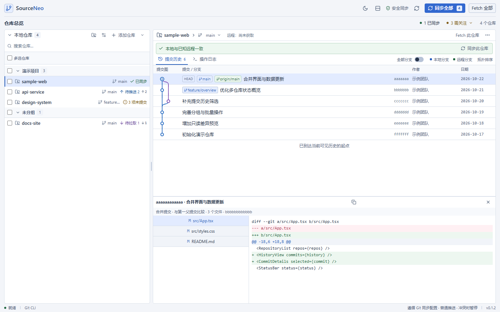

<p align="center">
  
</p>

# SourceNeo

SourceNeo 是一款 Windows / macOS 多仓库 Git 桌面工具。它集中展示仓库状态、提交历史与待处理事项，并提供手动 Fetch、同步和分支切换。界面为中文，基于 Tauri 2、React 和本机 Git。



*界面预览使用演示数据，不包含真实仓库。*

## 下载

从 [GitHub Releases](https://github.com/SakuraYuki/SourceNeo/releases) 下载 Windows x64 安装包或 macOS arm64 应用归档。当前构建未做开发者签名，macOS 应用未公证。

## 主要功能

- 管理多个本地仓库与 worktree，按分组、搜索和状态筛选，支持批量 Fetch 与同步。
- 查看当前分支、未提交文件、同步状态和需关注事项；状态刷新不会自动联网。
- 浏览真实提交拓扑、切换当前分支 / 全部分支历史，并查看提交详情与只读 diff。
- 从仓库打开终端或编辑器，复制脱敏诊断信息，交给外部工具处理提交和冲突。

所有远程操作都由用户手动触发。同步遵循仓库的 Git 配置；遇到冲突、未提交改动或不明确的分支关系时会暂停，不会自动丢弃文件或强制推送。详见[同步规则与安全边界](docs/sync.md)。

## 从源码运行

需要 Node.js 22.13+、Rust 1.90+、Git 2.30+ 和对应平台的 [Tauri 开发依赖](https://v2.tauri.app/start/prerequisites/)：

```sh
npm ci
npm run desktop
```

浏览器中的 `npm run dev` 只能预览界面，不能操作本地 Git。打包和验证命令见[开发与验证](docs/development.md)。

## 文档

- [使用指南](docs/usage.md)：界面、仓库操作、Fetch、外部工具与配置。
- [同步规则与安全边界](docs/sync.md)：同步决策、冲突和文件保护。
- [开发与验证](docs/development.md)：环境、构建、测试及实现结构。
- [验证状态](docs/validation.md)：当前版本的自动检查、发布范围与验证边界。
