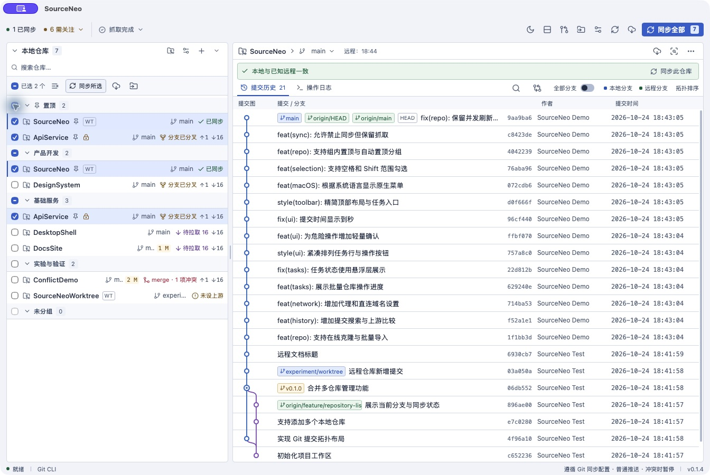
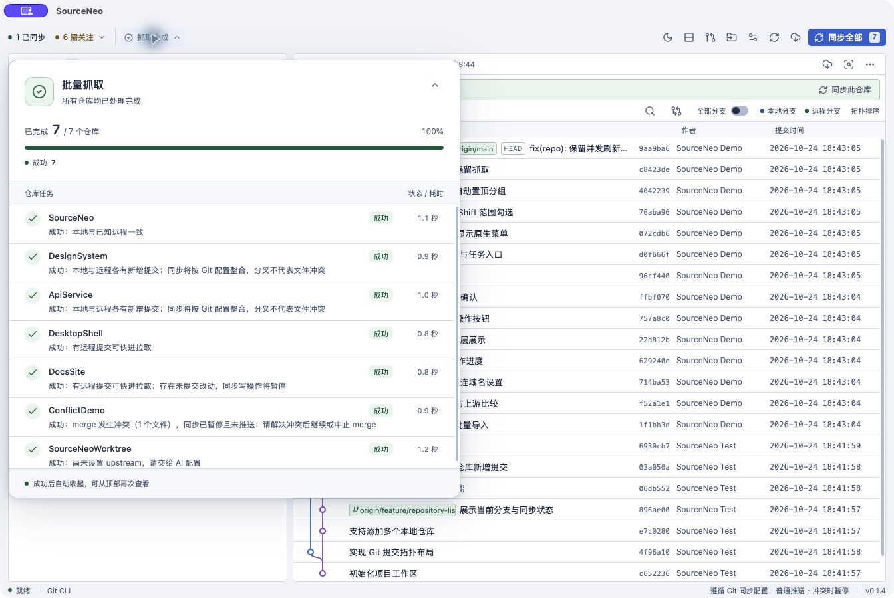

<p align="center">
  
</p>

# SourceNeo

SourceNeo 是一款 Windows / macOS 多仓库 Git 桌面工具。它集中展示仓库状态、提交历史与待处理事项，并提供手动抓取（Git fetch）、同步和分支切换。界面为中文，基于 Tauri 2、React 和本机 Git。



*v0.1.4 原生界面截图，使用独立演示仓库，不包含个人或业务仓库信息。*

## 下载

从 [GitHub Releases](https://github.com/SakuraYuki/SourceNeo/releases) 下载 Windows x64 安装包或 macOS arm64 应用归档。当前构建未做开发者签名，macOS 应用未公证。

## 主要功能

以下功能对应当前源码；已发布安装包的功能以对应 Release 为准。

- 从 HTTPS / SSH 克隆远程仓库，或扫描父目录批量导入本地仓库。
- 管理多个本地仓库与 worktree，按分组、搜索和状态筛选，支持批量抓取与同步。
- 置顶常用仓库：在原分组内前置，并集中显示在顶部自动“置顶”分组；两处共享勾选，批量操作不重复执行。
- 为指定仓库标记“禁止同步”：所有同步入口均拦截，批量同步自动跳过，仍可单独或批量抓取；标记重启后保留。
- 点击仓库行后按空格切换勾选，按住 Shift 连续选择；筛选或折叠分组后保留原有选择。
- 查看当前分支、未提交文件、同步状态和需关注事项；状态刷新不会自动联网。
- 搜索未加载的提交历史、比较当前分支与上游，并在同步前查看只读计划。
- 浏览真实提交拓扑、切换当前分支 / 全部分支历史，并查看提交详情与只读 diff。
- 通过悬浮任务面板查看批量操作阶段、停止排队和重试失败项；展开不挤动主界面，全部成功后自动收起，也可手动或按 Esc 收起。
- 配置应用内代理与直连域名，适用于抓取、同步和 HTTPS 克隆，不修改全局 Git 配置。
- 操作日志跨重启保存，支持筛选与导出；紧凑工具栏、明暗主题和细滚动条，macOS 原生菜单随系统首选语言显示中文或英文。
- 从仓库打开终端或编辑器，复制脱敏诊断信息，交给外部工具处理提交和冲突。

所有远程操作都由用户手动触发。同步遵循仓库的 Git 配置；遇到冲突、未提交改动或不明确的分支关系时会暂停，不会自动丢弃文件或强制推送。详见[同步规则与安全边界](docs/sync.md)。

## 批量任务

任务入口位于顶部状态区，可随时展开查看进度、结果与耗时。停止排队先进行轻量确认，只跳过尚未开始的任务；进行中的 Git 操作继续完成。



## 从源码运行

需要 Node.js 22.13+、Rust 1.90+、Git 2.30+ 和对应平台的 [Tauri 开发依赖](https://v2.tauri.app/start/prerequisites/)：

```sh
npm ci
npm run desktop
```

浏览器中的 `npm run dev` 只能预览界面，不能操作本地 Git。打包和验证命令见[开发与验证](docs/development.md)。

## 文档

- [使用指南](docs/usage.md)：界面、仓库操作、抓取、外部工具与配置。
- [同步规则与安全边界](docs/sync.md)：同步决策、冲突和文件保护。
- [开发与验证](docs/development.md)：环境、构建、测试及实现结构。
- [签名构建](docs/release-signing.md)：可选的手动签名与公证流程。
- [验证状态](docs/validation.md)：当前版本的自动检查、发布范围与验证边界。
